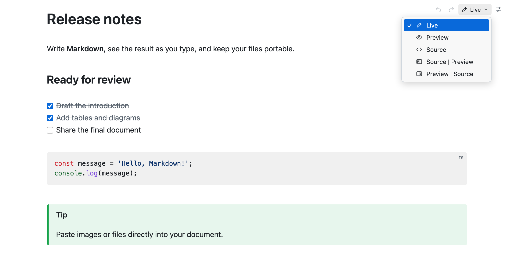
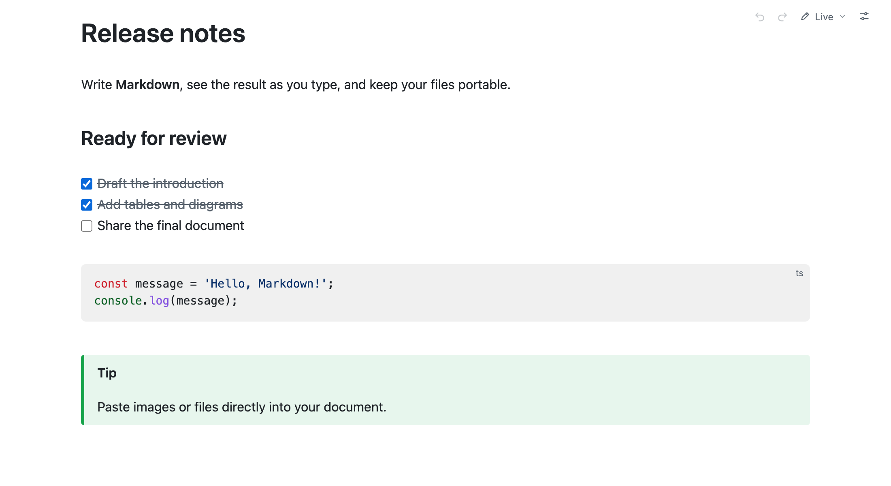
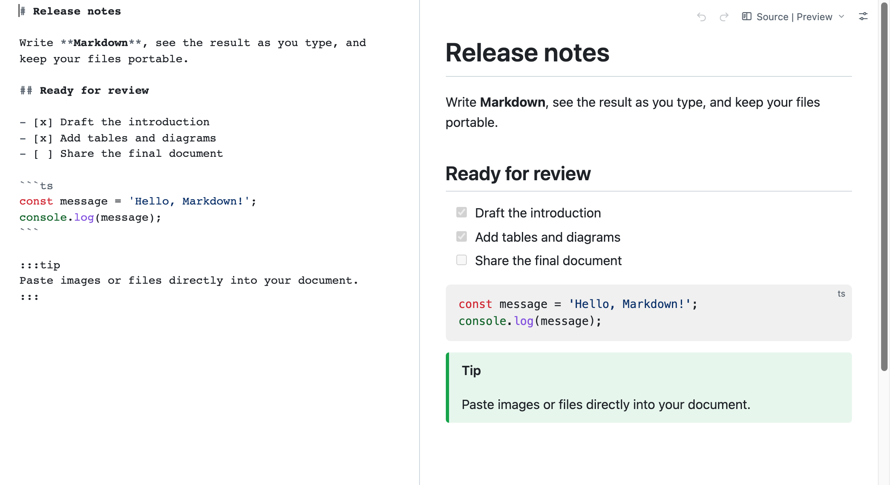
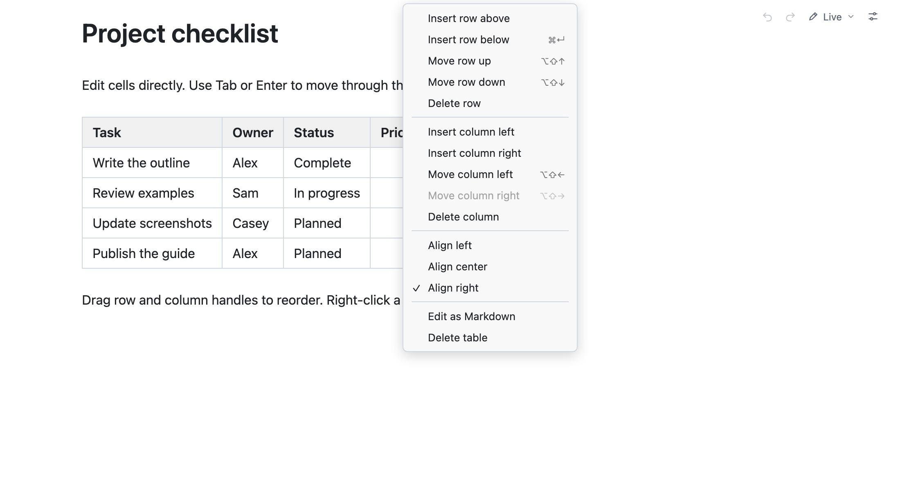
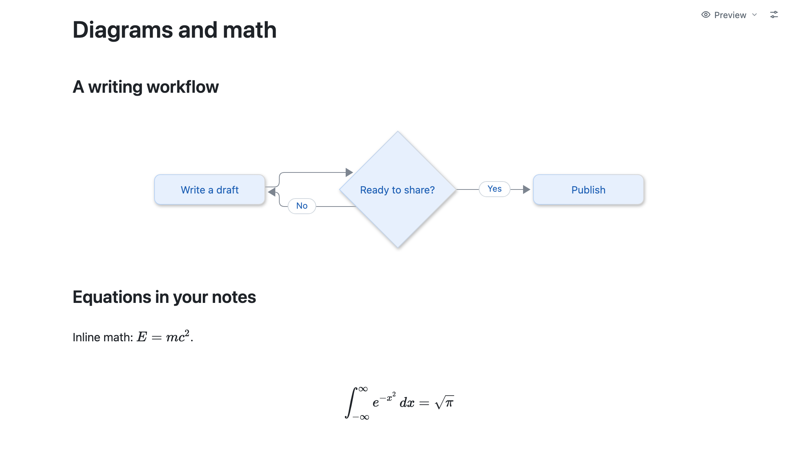

# Neat MD - Markdown Editor

English | [简体中文](MARKETPLACE.zh-CN.md)

Edit and read Markdown in VS Code. Write with live rendering, edit source, or compare both side by side. Files stay plain Markdown.

## Switch between five modes

Click the mode button in the top-right corner. Your choice is remembered and applies to all open Neat MD editors.

| Mode | Use it to |
| --- | --- |
| Live | Edit with Markdown rendered as you type |
| Preview | Read the rendered document without editing |
| Source | Edit Markdown source with syntax highlighting |
| Source \| Preview | Edit on the left and preview on the right |
| Preview \| Source | Preview on the left and edit on the right |

## Write in Live mode

Formatting appears as you type. Move the cursor into text to reveal its Markdown syntax. Check off tasks directly in the document.

## Edit source beside the preview

Use either split layout to see source and rendered output together. The preview updates as you edit, and scrolling stays synchronized.

## Work with tables

Edit cells in place. **Tab** moves across cells; **Enter** moves down. At the end, they add a column or row. Drag the handles to reorder rows and columns, or right-click a cell for insert, delete, and alignment actions. Choose **Edit as Markdown** to edit the table source.

## Add diagrams and math

Render Mermaid diagrams and KaTeX formulas (`$…$` inline or `$$…$$` blocks). In Live mode, double-click a diagram or formula to edit its source while keeping the rendered result visible below.

## Paste images, files, and rich text

Paste or drop images and files to save them beside your document in an `assets` folder and insert relative links. Change the folder or embed images as Base64 in **Settings**. Pasted rich text becomes Markdown; copied content preserves Markdown syntax.

## Also included

- Headings, links, images, lists, blockquotes, and syntax-highlighted code.
- Footnotes, a table of contents (`[toc]`), and note/tip/info/warning/danger containers.
- Formatting shortcuts: **Cmd/Ctrl+B** for bold, **Cmd/Ctrl+I** for italic, **Cmd/Ctrl+E** for inline code, and **Cmd/Ctrl+K** for links.
- Find/replace with **Cmd/Ctrl+F** or **Cmd/Ctrl+R**.
- VS Code Undo/Redo, Save, Save As, and recovery of unsaved changes.
- Theme colors from VS Code; font size, line height, content width, diagram theme, and English/Simplified Chinese in the top-right **Settings**.

## Getting started

Install the extension, then open a `.md`, `.markdown`, or `.mdown` file. If needed, choose **Neat MD** from **Reopen Editor With**. Use **Reopen as Text** in the editor title bar to return to VS Code's text editor. Requires desktop VS Code 1.95+.

## License

Licensed under [AGPL-3.0-only](LICENSE). [Source code](https://github.com/xiaomingio/neat-md).
