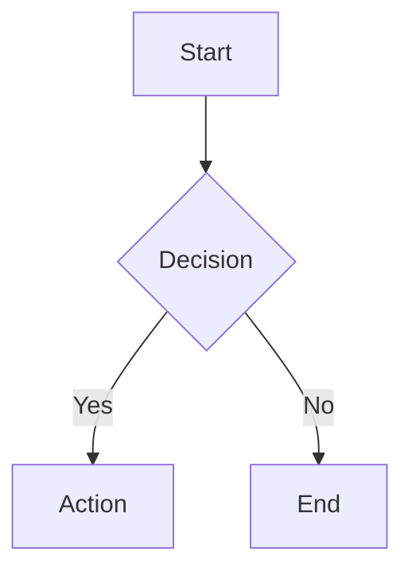

# Neat MD - Markdown Editor

Edit Markdown with live preview, WYSIWYG editing, Mermaid diagrams, and KaTeX math formulas in VS Code.

## Features

### 🎨 Four View Modes

- **Live**: WYSIWYG editing with Typora-style instant rendering
- **Source**: Plain text markdown editor with syntax highlighting
- **Source | Preview**: Edit source on left, live preview on right
- **Preview | Source**: Live preview on left, edit source on right

### 📝 Rich Markdown Support

- **GitHub Flavored Markdown (GFM)**: Headers, bold, italic, strikethrough, links, images
- **Tables**: GFM tables with alignment support
- **Task Lists**: `- [ ]` and `- [x]` checkbox lists
- **Code Blocks**: Syntax highlighting for 20+ languages
- **Blockquotes**: Nested quote support
- **Footnotes**: `[^1]` reference style footnotes
- **Table of Contents**: Auto-generated with `[[TOC]]`
- **Custom Containers**: Note, tip, warning, danger, info blocks

### 📊 Diagrams and Math

- **Mermaid Diagrams**: Flowcharts, sequence diagrams, class diagrams, state diagrams, gantt charts, pie charts
- **KaTeX Math**: Inline `$formula$` and block `$$formula$$` rendering
- **Lazy Loading**: Diagrams render only when visible for better performance

### ⚡ Performance Optimized

- **Incremental Rendering**: Only changed blocks re-render
- **Debounced Sync**: Smooth split-view updates (configurable delay)
- **Scroll Sync**: Bidirectional scrolling between source and preview
- **Fast Editing**: Low-latency input response

### 🎯 Smart Editing

- **Interactive tables**: Edit cells in place. Tab and Enter move between cells and add a column or row at the end; drag row and column handles to reorder; right-click for more
- **Paste anything**: Images and files are saved to an `assets` folder next to your file (configurable); rich text from web pages becomes Markdown
- **Copy as Markdown**: Copying always gives you the Markdown source
- **Keyboard Shortcuts**: Quick formatting with `Ctrl/Cmd+B`, `Ctrl/Cmd+I`, etc.
- **Standard Markdown**: 100% compatible - no proprietary extensions

## Usage

1. Open any `.md`, `.markdown`, or `.mdown` file
2. VS Code will prompt to choose an editor - select **Neat MD**
3. Pick a view mode from the button in the top-right corner (Live, Preview, Source and two split views); your choice applies to every Markdown file. Undo and redo buttons sit next to it

### Keyboard Shortcuts

| Shortcut | Action |
|----------|--------|
| `Ctrl/Cmd+B` | Bold |
| `Ctrl/Cmd+I` | Italic |
| `Ctrl/Cmd+E` | Inline code |
| `Ctrl/Cmd+K` | Insert link |
| `Ctrl/Cmd+F` | Find |
| `Ctrl/Cmd+R` | Replace |

## Configuration

Open the settings button next to the mode button, or **Settings > Neat MD**:

- **Attachment folder**: Where pasted images and files go (default `assets`; `${filename}` is the Markdown file name)
- **Embed images**: Store pasted images as Base64 inside the Markdown instead
- **Font size, line height, content width**
- **Diagram theme**: Follow VS Code, default, neutral, dark, forest
- **Table of contents depth** and **interface language**

## Examples

### Mermaid Diagram

### Math Formula

Inline: $E = mc^2$

Block:

$$
\int_0^\infty e^{-x^2} dx = \frac{\sqrt{\pi}}{2}
$$

### Custom Container

:::warning
This is a warning message.
:::

## Requirements

- VS Code 1.95.0 or higher

## License

This extension is licensed under **AGPL-3.0-only**.

Source code: [https://github.com/xiaomingio/neat-md](https://github.com/xiaomingio/neat-md)

## Privacy

All markdown processing happens locally. No data is sent to external servers.

---

**Enjoy editing Markdown with Neat MD!**
