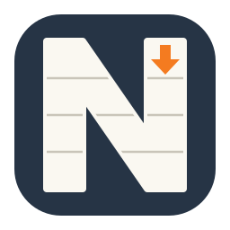
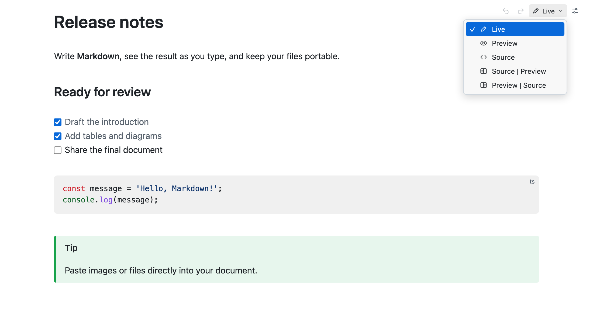
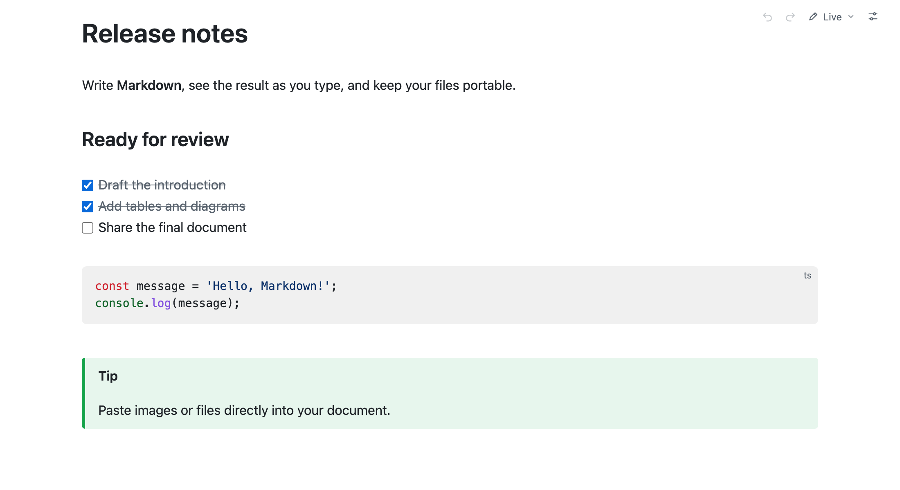
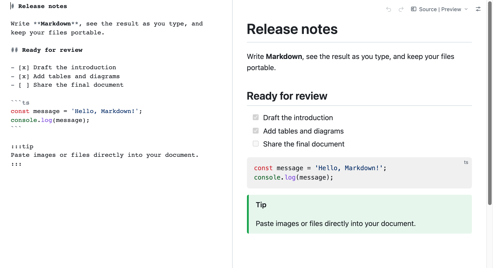
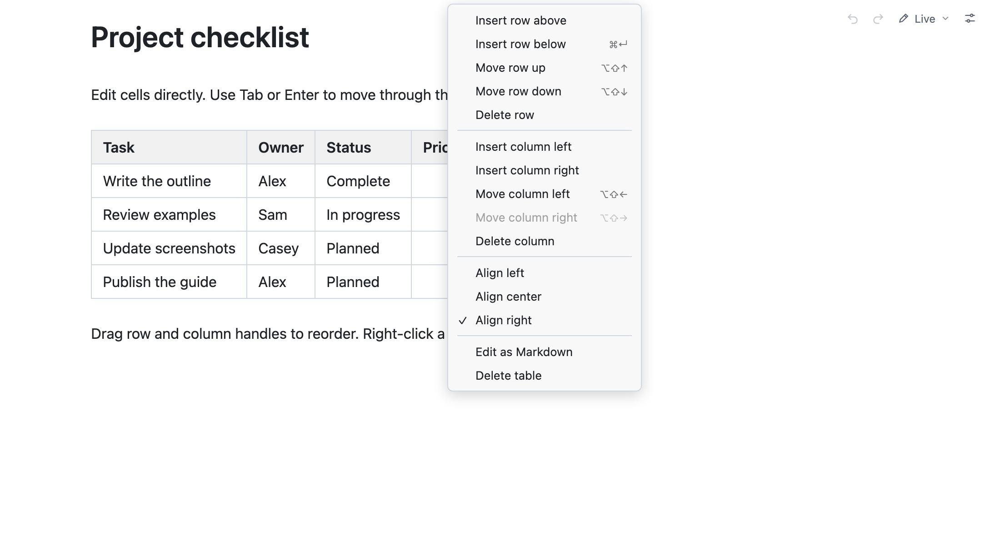
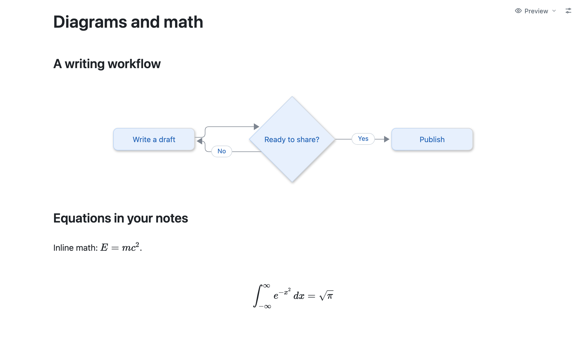

# Neat MD - Markdown Editor

[English](MARKETPLACE.md) | 简体中文

在 VS Code 中编辑和阅读 Markdown。边写边预览、编辑源码，或将两者并排对照。文件以纯 Markdown 保存。

## 切换五种模式

点击右上角模式按钮。所选模式会被记住，并应用于所有已打开的 Neat MD 编辑器。

| 模式 | 用途 |
| --- | --- |
| Live | 边写边渲染 Markdown |
| Preview | 只读浏览渲染后的文档 |
| Source | 编辑 Markdown 源码，支持语法高亮 |
| Source \| Preview | 左侧编辑源码，右侧预览 |
| Preview \| Source | 左侧预览，右侧编辑源码 |

## 在 Live 模式中写作

输入时即时显示格式。将光标移入文字可查看 Markdown 语法，也可直接勾选文档中的任务。

## 对照预览编辑源码

两种分栏布局均可同时显示源码与渲染结果。编辑时预览自动更新，两侧滚动同步。

## 编辑表格

直接编辑单元格。**Tab** 向右移动，**Enter** 向下移动；到达末列或末行时自动新增一列或一行。拖动手柄调整行列顺序，或右击单元格进行插入、删除和对齐。选择 **Edit as Markdown** 可编辑表格源码。

## 添加图表与公式

渲染 Mermaid 图表和 KaTeX 公式（行内使用 `$…$`，公式块使用 `$$…$$`）。在 Live 模式下，双击图表或公式即可编辑源码，下方同时保留渲染结果。

## 粘贴图片、文件和富文本

粘贴或拖入图片与文件，自动保存到文档旁的 `assets` 文件夹，并插入相对链接。在 **Settings** 中可修改文件夹或将图片以 Base64 嵌入文档。粘贴的富文本会转换为 Markdown；复制内容时保留 Markdown 语法。

## 其他功能

- 标题、链接、图片、列表、引用和代码高亮。
- 脚注、目录（`[toc]`）及 note/tip/info/warning/danger 容器。
- 格式快捷键：**Cmd/Ctrl+B** 加粗、**Cmd/Ctrl+I** 斜体、**Cmd/Ctrl+E** 行内代码、**Cmd/Ctrl+K** 插入链接。
- 使用 **Cmd/Ctrl+F** 或 **Cmd/Ctrl+R** 查找替换。
- VS Code 撤销重做、保存、另存为和未保存内容恢复。
- 配色跟随 VS Code；右上角 **Settings** 可调整字号、行高、内容宽度、图表主题和中英文界面。

## 开始使用

安装扩展后，打开 `.md`、`.markdown` 或 `.mdown` 文件。必要时通过 **Reopen Editor With** 选择 **Neat MD**。编辑器标题栏的 **Reopen as Text** 可返回 VS Code 文本编辑器。需要桌面版 VS Code 1.95 或更新版本。

## 许可证

代码采用 [AGPL-3.0-only](LICENSE)。[源代码](https://github.com/xiaomingio/neat-md)。

代码许可不授予 Neat MD 名称或 Logo 的商标权。另行发布自己的产品时，请使用自己的品牌。
