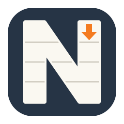

# Neat MD - Markdown Editor

[English](README.md) | 简体中文

在 VS Code 中编辑和阅读 Markdown。边写边预览、直接编辑源码，或将源码与预览并排显示。

## 功能

- 五种视图模式：Live、Preview、Source、Source | Preview 和 Preview | Source。
- 表格内直接编辑单元格，支持行列操作和拖动排序。
- Mermaid 图表、KaTeX 公式、代码高亮、任务列表、脚注和目录。
- 粘贴或拖入图片与文件，将富文本转为 Markdown，复制时保留 Markdown 语法。
- 格式快捷键、查找替换、撤销重做、另存为和未保存内容恢复。
- 跟随 VS Code 主题，支持英文和简体中文界面。

查看[功能指南及截图](MARKETPLACE.zh-CN.md)。

## 安装与打开

需要桌面版 VS Code 1.95 或更新版本。从 [Marketplace 安装 Neat MD](https://marketplace.visualstudio.com/items?itemName=xiaomingio.neat-md)，然后打开 `.md`、`.markdown` 或 `.mdown` 文件。也可通过 **Extensions → Install from VSIX…** 安装 VSIX。必要时使用 **Reopen Editor With → Neat MD**。

点击右上角按钮选择模式。编辑器标题栏的 **Reopen as Text** 可返回 VS Code 文本编辑器。

## 本地开发

需要 Node.js 和 npm。

```sh
npm ci
npm run typecheck
npm test
npm run build
npx playwright install chromium --only-shell
npm run test:ui
npm run package
```

`src/extension.ts` 注册编辑器；`src/markdown.ts` 渲染 Markdown；`src/webview/` 实现编辑和预览。测试位于 `tests/`，示例文档位于 `examples/`。

截图位于 `docs/images/`，运行 `npm run build && node scripts/screenshots.mjs` 更新。构建输出到 `dist/`，VSIX 输出到 `release/`。打包使用 [MARKETPLACE.md](MARKETPLACE.md) 作为插件市场介绍。

通过环境变量注入 `VSCE_PAT`，运行 `npm run publish:marketplace` 发布当前已打包版本。命令会发布 `release/` 中对应版本的 VSIX，不修改版本号。

## 许可证

代码采用 [GNU Affero General Public License v3.0](LICENSE)（仅第 3 版，`AGPL-3.0-only`）。

代码许可不授予 Neat MD 名称或 Logo 的商标权。另行发布自己的产品时，请使用自己的品牌。
