# Neat MD Sample

A tour of everything Neat MD renders. Click into any element to see its Markdown; move away and it renders again.

[toc]

## Text

**Bold**, *italic*, ***bold italic***, ~~strikethrough~~, `inline code`, a [link](https://github.com), an autolink <https://example.com>, and a footnote[^note].

Line one ends with two spaces
so this is a hard line break.

> Blockquotes can hold **formatting**, `code` and
> several lines.
>
> > And they can be nested.

---

## Lists

- A short item
- A long item whose text keeps going well past the right edge of the editor, so you can see that wrapped lines line up with the text after the bullet instead of falling back under it.
  - Nested items get their own bullet and indent, and wrapped lines in a nested item also align with that item's text rather than with its parent.
    - Third level, with a long enough sentence to wrap onto a second line in a normal window width.
- Back to the first level

1. First step
2. Second step with a long explanation that wraps onto the next line, which should start right under the word "Second" and not under the number.
   1. Sub-step one
   2. Sub-step two
10. Double-digit numbers keep the text aligned too
11. Eleven

- [x] Write the spec
- [x] Build the editor, including a long task description that wraps so the checkbox stays in its own column
- [ ] Publish
  - [ ] Nested task

## Tables

Simple, with alignment:

| Left | Center | Right |
| :--- | :----: | ----: |
| a    |   b    |     1 |
| c    |   d    |    22 |

Wide table that scrolls sideways; columns keep their natural width:

| ID   | Name                      | Region        |     Status     | Owner         | Created    | Updated    | Tags         | Priority | Notes                                      |
| ---- | ------------------------- | ------------- | :------------: | ------------- | ---------- | ---------- | ------------ | -------: | ------------------------------------------ |
| 1001 | Login page redesign       | North America |     ✅ Done     | Alice Johnson | 2026-01-04 | 2026-02-11 | `ui`, `auth` |        1 | Shipped behind a feature flag first        |
| 1002 | **Payment retries**       | Europe        | 🚧 In progress | Bob Smith     | 2026-01-15 | 2026-03-02 | `billing`    |        2 | Needs [design review](https://example.com) |
| 1003 | 搜索结果排序优化          | 亚太地区      |   ⏳ Waiting    | 王小明        | 2026-02-01 | 2026-03-20 | `search`     |        3 | 中文内容和英文 mixed content               |
| 1004 | Escaped \| pipe in a cell | Global        |   ❌ Blocked    | Carol         | 2026-02-10 | 2026-02-10 | `infra`      |        5 | Formula $O(n \log n)$ inside a cell        |

Cells with long text wrap at a comfortable width:

| Term | Definition |
| --- | --- |
| Idempotent | An operation that produces the same result no matter how many times it is applied, which makes retries safe after timeouts or network failures. |
| Eventual consistency | Replicas may briefly disagree after a write, but converge to the same value once updates stop arriving. |

## Code

```ts
interface User {
  id: number;
  name: string;
}

export async function load(id: number): Promise<User> {
  const res = await fetch(`/api/users/${id}`);
  if (!res.ok) throw new Error(`HTTP ${res.status}`);
  return res.json();
}
```

```python
from dataclasses import dataclass

@dataclass
class Point:
    x: float
    y: float

    def norm(self) -> float:
        return (self.x ** 2 + self.y ** 2) ** 0.5
```

```bash
npm install && npm run build
```

## Math

Inline: $E = mc^2$, $\alpha + \beta = \gamma$, and $\sum_{i=1}^{n} i = \frac{n(n+1)}{2}$. Prices like $5 and $10 stay text.

Gaussian integral:

$$
\int_{-\infty}^{\infty} e^{-x^2}\,dx = \sqrt{\pi}
$$

A system of equations:

$$
\begin{cases}
2x + 3y - z = 1 \\
x - y + 2z = -2 \\
3x + y + z = 4
\end{cases}
$$

Aligned derivation:

$$
\begin{aligned}
(a + b)^2 &= (a + b)(a + b) \\
          &= a^2 + ab + ba + b^2 \\
          &= a^2 + 2ab + b^2
\end{aligned}
$$

Matrix and determinant:

$$
A = \begin{pmatrix} a_{11} & a_{12} & a_{13} \\ a_{21} & a_{22} & a_{23} \\ a_{31} & a_{32} & a_{33} \end{pmatrix},
\qquad
\det(A) = \sum_{\sigma \in S_3} \operatorname{sgn}(\sigma) \prod_{i=1}^{3} a_{i,\sigma(i)}
$$

Maxwell's equations:

$$
\begin{aligned}
\nabla \cdot \mathbf{E} &= \frac{\rho}{\varepsilon_0} &
\nabla \cdot \mathbf{B} &= 0 \\
\nabla \times \mathbf{E} &= -\frac{\partial \mathbf{B}}{\partial t} &
\nabla \times \mathbf{B} &= \mu_0 \mathbf{J} + \mu_0 \varepsilon_0 \frac{\partial \mathbf{E}}{\partial t}
\end{aligned}
$$

## Diagrams

### Flowchart with labeled edges and subgraphs

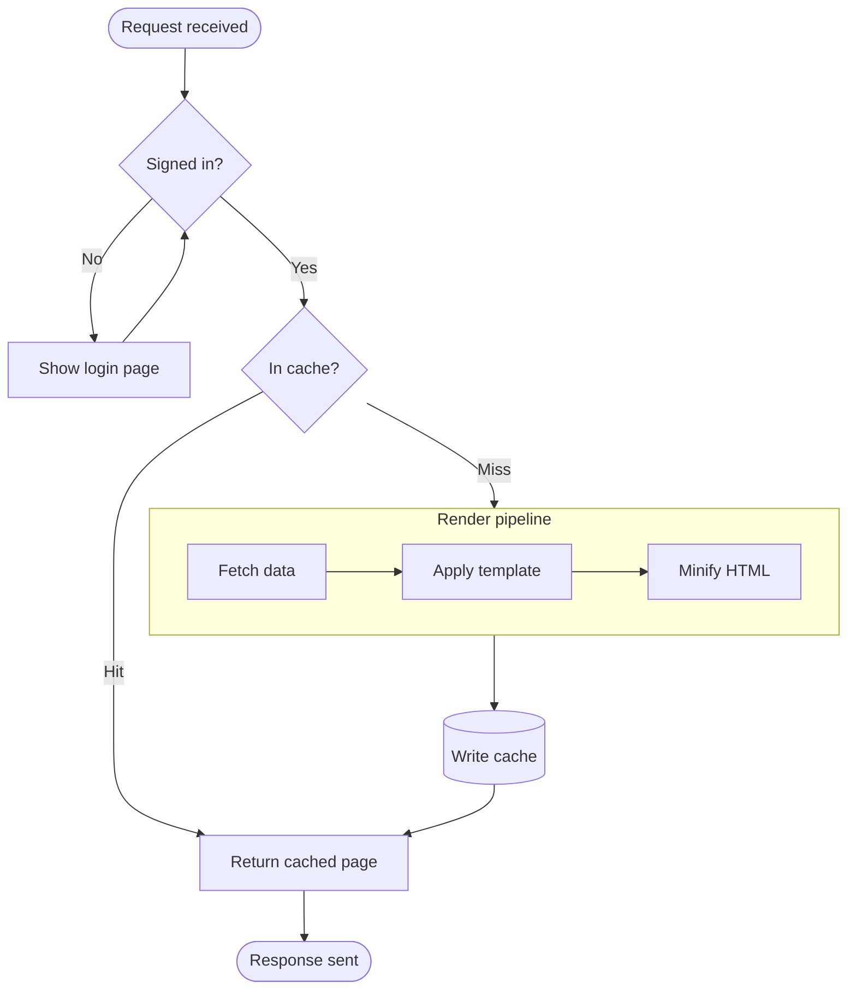

### Sequence diagram

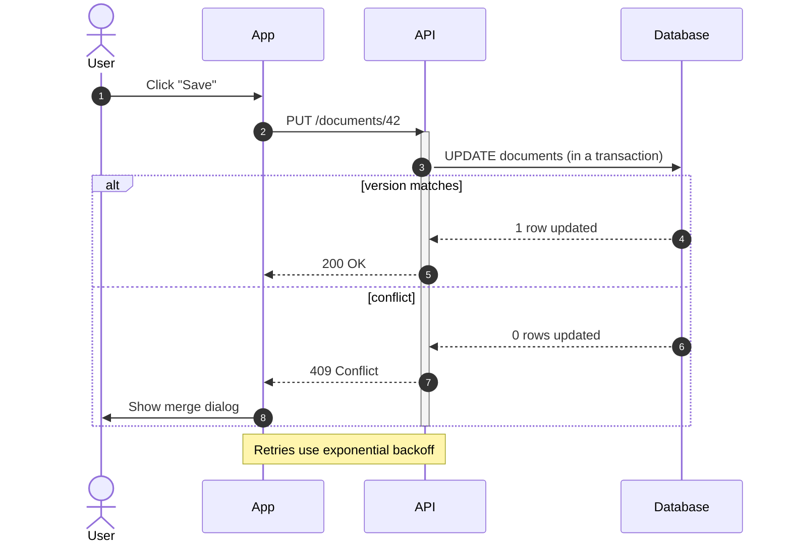

### Class diagram

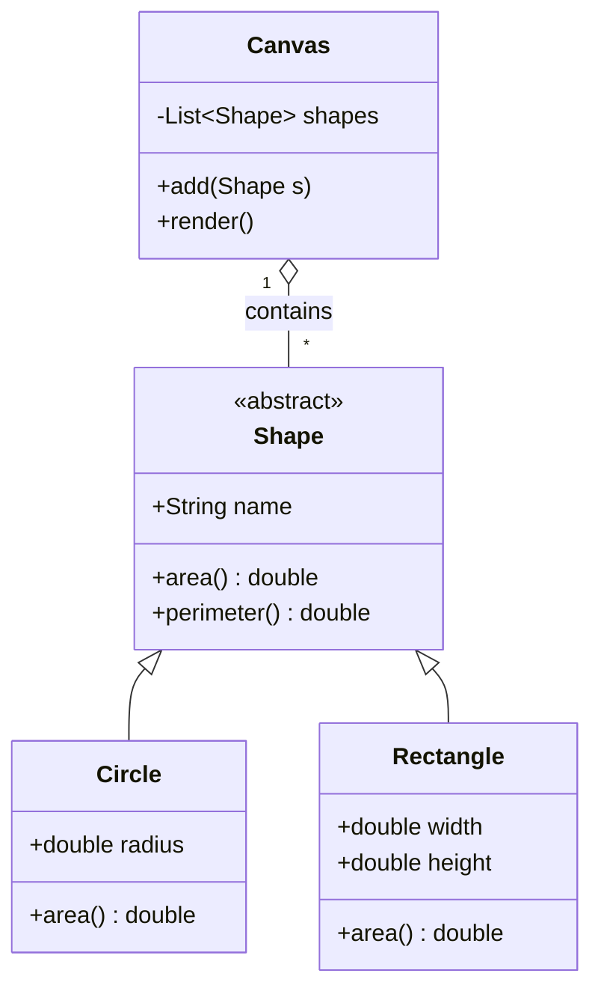

### State diagram

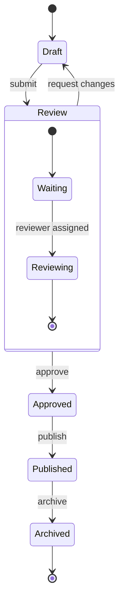

### Entity relationship diagram

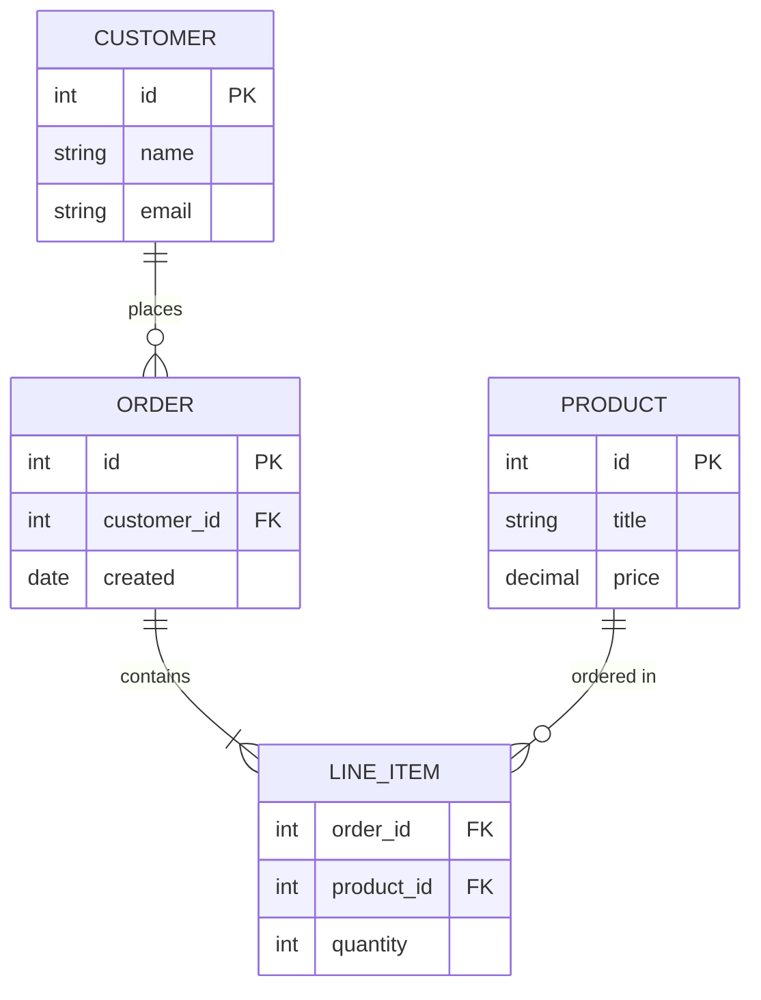

### Gantt chart

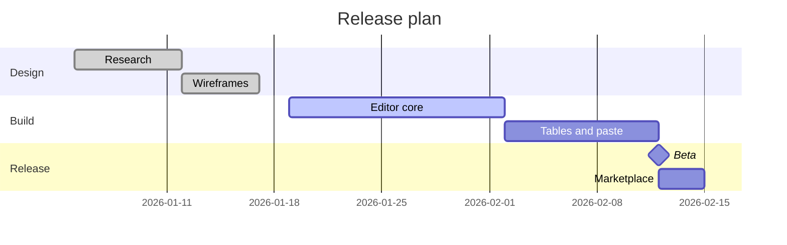

### Pie chart

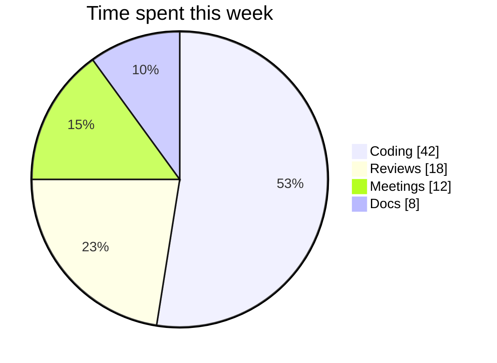

### User journey

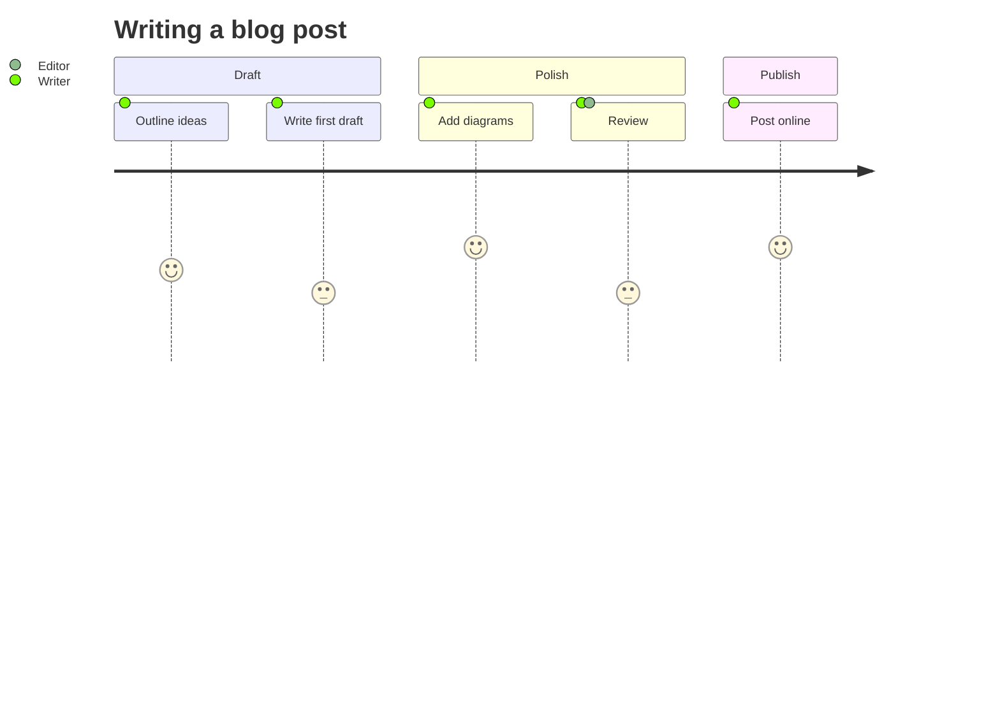

### Git graph

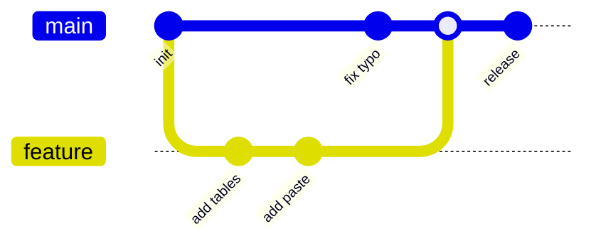

### Mind map

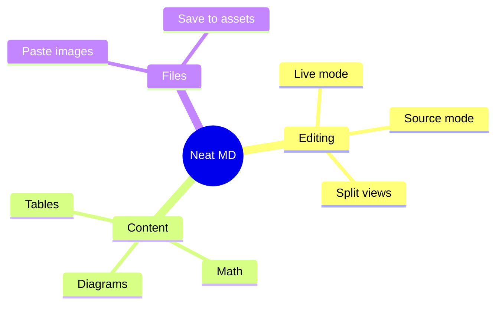

### Timeline

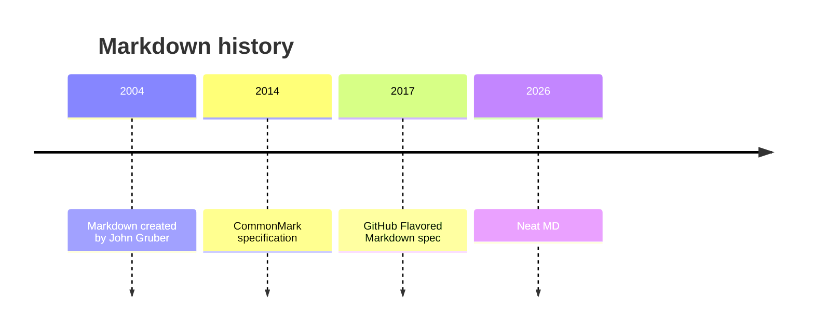

### Quadrant chart

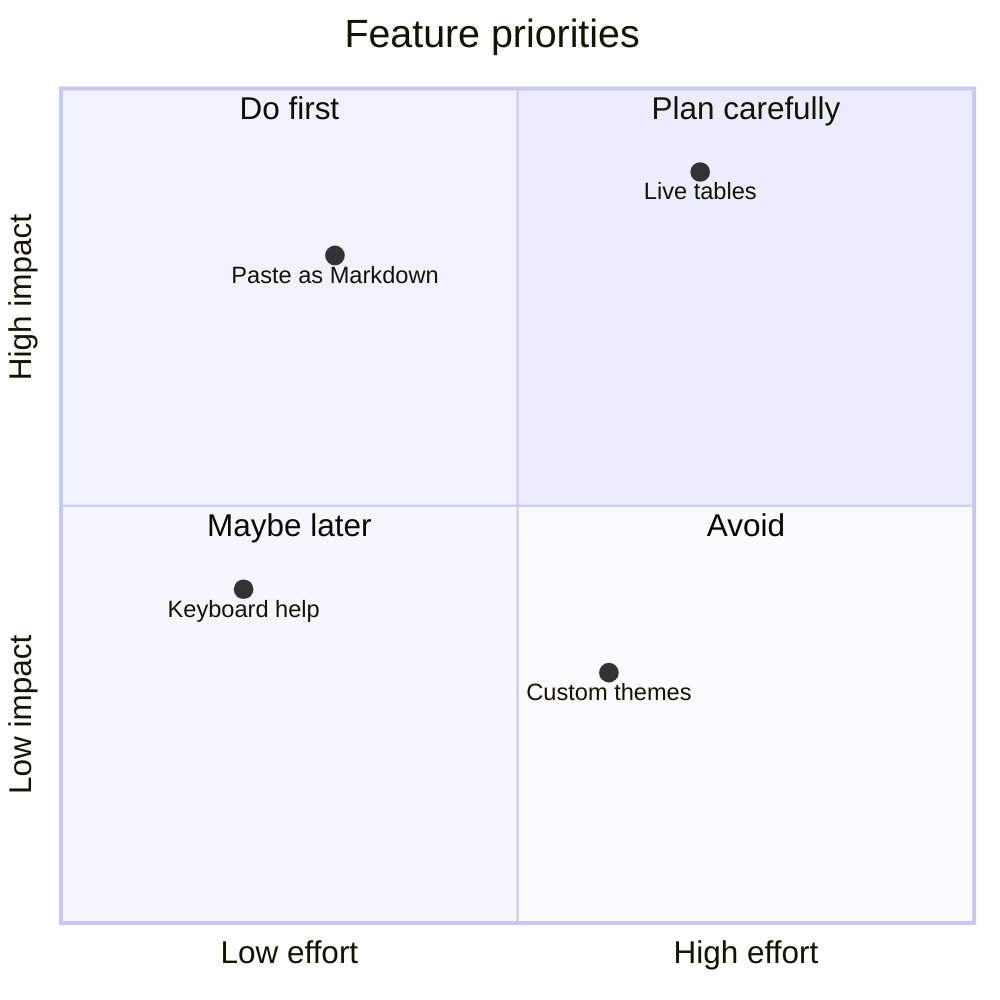

## Containers

:::note
A note with **formatting** and a list:

- one
- two
:::

:::tip Pro tip
Containers can have their own title.
:::

:::warning
Mind the gap.
:::

:::danger
Do not run this in production.
:::

## Images


Paste or drop an image here: it is saved to the `assets` folder next to this file.

[^note]: Footnotes collect at the end of the document.
